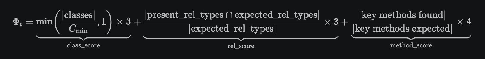
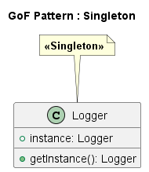
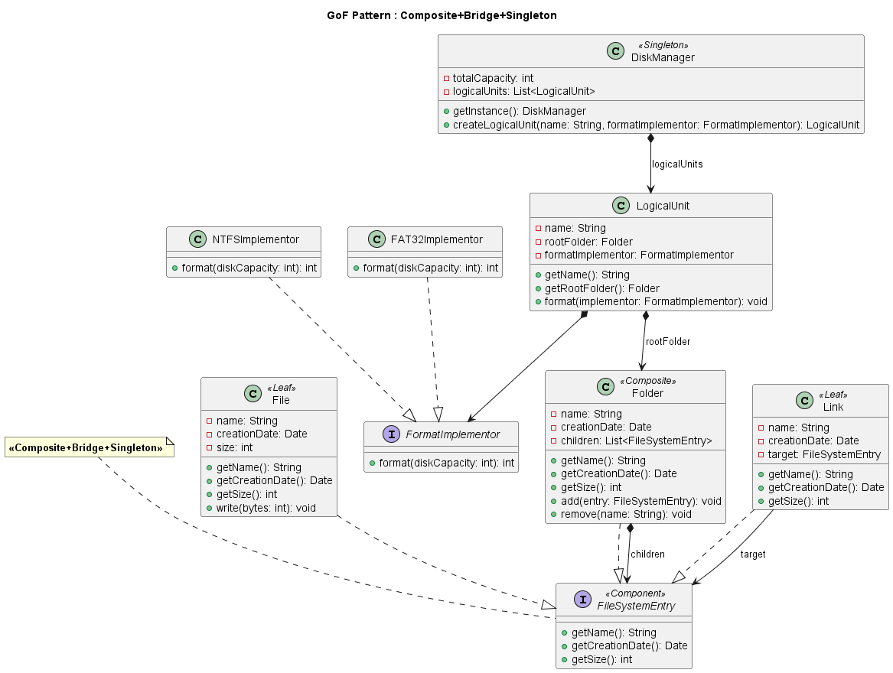

# gof1 — GoF Pattern Detector with Active Inference

## Introduction: CIITR Framework and the Wiki Pattern

Tor-Ståle Hansen's CIITR framework (see his paper of December 2, 2025) defines the minimal
conditions (Φᵢ, Rᵍ, and Comprehension per Joule) for "validating" an AI's "artificial" comprehension. The paper stresses
the value of running AI inference on sovereign silicon rather than in the cloud, particularly for
computing energy consumption.

The LLM wiki pattern (from Karpathy) compiles and accumulates knowledge into a self-maintaining wiki
(*Query Once, Reuse Forever*). A wiki pattern is used as a personal knowledge base.

CIITR and the LLM wiki pattern therefore both operate within a local (non-cloud, personal) frame —
which is why I thought the LLM wiki could be measured through CIITR's metrics. That's the modest
ambition of the POC that follows.

CIITR defends the thesis that locally constrained systems (bounded memory, stable rhythm Rᵍ, high
CPJ) can outperform massive architectures on certain points.

---

## The Framework CIITR's metrics

Comprehension is defined as:

**Cᵢ = Φᵢ × Rᵍ**

| Symbol | Meaning |
|--------|---------|
| **Φᵢ** | Structural integration — completeness of the generated diagram against its declared pattern(s) |
| **Rᵍ** | Rhythmic coherence — empirical stability of the agent's inference cadence across a session |
|      | Rᵍ can be understood as a dispersion measure (coefficient of variation) of the inference throughput (tokens/s) |
| **CPJ** | Comprehension per Joule = Cᵢ / energy (epistemic efficiency) |

### Energy

$$E = t \times P$$

| Symbol | Meaning | Value |
|--------|---------|-------|
| `t` | LLM inference duration (seconds) | measured per call |
| `P` | constant thermal power of the inference backend | 28 W (Ollama, local/remote) or 12 W (`--mlx`, Apple M-series Neural Engine + GPU) |
| `E` | energy consumed (joules) | variable |

### Φᵢ — Structural Integration

The first formula tested for Φᵢ was `n_classes + 2 × n_relationships` — a raw entity/relationship
count with no reference to what the declared pattern actually requires. It was too simplistic to
reflect the quality of the generated diagram: a diagram with plenty of classes and relationships
could score high while missing the pattern's defining structure (e.g. no `getInstance()` in a
"Singleton", or no inheritance link in an "Adapter"), and a minimal-but-correct diagram could score
low simply for being small. It was replaced by the per-pattern scoring below.

For each pattern the diagram declares, Φᵢ is bounded to `[0, 10]`:



| Component | Weight | Criterion |
|-----------|--------|-----------|
| `class_score` | 0–3 | generated classes ≥ pattern minimum (`C_min`) |
| `rel_score` | 0–3 | canonical relationship types of the pattern present in the diagram |
| `method_score` | 0–4 | key method fragments found in generated signatures |

The canonical schema per pattern (`min_classes`, `expected_rel_types`, `key_methods`) is defined in
[gof/schema.py](gof/schema.py) for all 23 GoF patterns. When a diagram declares several patterns
(e.g. `"Composite+Singleton"`), Φᵢ is the average of each recognized pattern's score; a declared
pattern absent from the schema is skipped, and Φᵢ = 0 if none are recognized. Implementation:
[gof/metamodel.py](gof/metamodel.py).

Φᵢ is a property of the **generated diagram** — computed the same way whether the diagram came from
LLM_ONLY or LLM_AI.

Φᵢ in particular proved concretely diagnostic in this project: an unexpectedly low score combined
with an implausible multi-pattern detection — for example a plain "single logger instance" objective
coming back as "Observer+Facade+Singleton" when the expected solution was a **pure** Singleton (i.e.
Φᵢ = 10) — is what first exposed the wiki cross-session contamination bug in
`agent_ai/gof_ai_agent.py::analyze()`: a real defect caught by the metric, not just a theoretical
construct.

### Rᵍ — Rhythmic Coherence

- **LLM alone → Rᵍ = 0**: a single stateless call, no session persistence, no recursive re-entry —
  there is no rhythm to measure.
- **Active Inference agent → Rᵍ > 0**: `analyze → generate → update_wiki` repeats every iteration with
  a persistent memory (the wiki) carried across cycles, so an inference rhythm can be measured — and
  can stay coherent or drift.

According to C2TR.md (Tor-Ståle Hansen), Rᵍ tracks the regularity of token cadence and phase jitter
across inference cycles — see below for the concrete computation.

An agent generating at 50 tokens/s in a perfectly constant way from one call to the next gives a high Rᵍ.
An agent generating at 50 tokens/s but erratically (sometimes 20, sometimes 80) gives a low Rᵍ.

### Understanding-Event Predicate

`Cᵢ = Φᵢ × Rᵍ` is a **structural predicate, not a score** — the theory note behind this project,
*Why Understanding Is a Relational Property Between System, Structure, and Energy Cost*
(Tor-Ståle Hansen, December 2, 2025), states that the equation is "not a score or scalar, but a
structural predicate," and that understanding is a transient *event*, not a persistent system trait.
`is_understanding_event()` (`gof/metamodel.py`) checks, for each iteration, whether all three of the
following hold — an AND of independent gates, never averaged into a single ratio:

| Gate | Condition | Threshold | Why this threshold |
|------|-----------|-----------|---------------------|
| Φᵢ (structural integration) | `Φᵢ ≥ phi_floor` | 6.0 / 10 | 60% of the per-pattern scale — below this the diagram is too incomplete to count, regardless of rhythm |
| Rᵍ (rhythmic coherence) | `Rᵍ ≥ rg_floor` | 0.3 | a **magnitude** floor, not mere presence: `Rᵍ > 0` is trivially true in `LLM_AI` (`analyze()`+`update_wiki()` always contribute ≥ 2 cadence samples per iteration), so this does not distinguish between two `LLM_AI` runs; it only distinguishes `LLM_AI` from `LLM_ONLY` (where `Rᵍ = 0` is hard-coded) |
| Energy (CPJ collapse) | `energy ≤ 2 × median(session energies)` | 2.0× | relative to the *session's own* accepted-iteration median, not an absolute constant — raw CPJ varies by roughly a factor of 10 between single-pattern and multi-pattern sessions, so a fixed threshold would not transfer across sessions |

If any gate fails, the iteration returns `(False, reason)` — the reason names the first failed gate
(`phi_below_floor`, `rg_below_floor`, `energy_outlier`), logged per iteration in the CSV's
`Understanding_Event` / `Understanding_Reason` columns.

An **outlier** is a data point that deviates sharply from the rest of a distribution — here, an
iteration whose energy cost is disproportionate to the session's own typical cost, rather than a
fixed absolute value. Concretely, `energy_outlier` fires when `energy_j > 2 × median(session's
accepted-iteration energies)`: the CPJ-collapse signature (e.g. the LLM looping or over-generating)
gets flagged even if Φᵢ and Rᵍ both look fine, because the disproportionate cost invalidates Φᵢ×Rᵍ
as a reliable signal for that iteration.

**Worked example** (GOF-001, "Logger" Singleton, 4 non-warmup iterations each):

| | Local (`llama3.1:8b`) | Remote (`devstral-small-2:24b`) |
|---|---|---|
| Φᵢ | 10, 6, 10, 10 (varies — occasionally misses the mandatory `getInstance` name) | 10, 10, 10, 10 (always perfect) |
| Rᵍ | 0.94 → 0.56 (decreasing, but always ≥ 0.3) | 0.21 – 0.25 (stable, always < 0.3) |
| Understanding events | **4 / 4** | **0 / 4** |

Despite a perfect Φᵢ every time, the remote run never registers as an understanding event — it stays
in the "apparent competence" region (high Φᵢ, insufficient Rᵍ) rather than "conditional
understanding." Reading Φᵢ alone would have called the remote run the better one; the three-gate
predicate captures what Φᵢ alone misses. (The local/remote gap is not yet fully isolated from the
model-choice confound — the remote endpoint only serves `devstral-small-2:24b`, so a same-model,
different-channel comparison is not currently possible.)

**Calibration status**: thresholds derived from 4 local sessions (GOF-001/008/009) and 2 remote
GOF-001 runs — provisional, not fixed constants. Re-derive them if the pattern mix or the LLM backend
changes materially.

---

## Project Architecture

```
gof1/
├── agent_ai/
│   ├── gof_ai_agent.py     # Wiki agent — 2 LLM calls: analyze() + update_wiki()
│   └── wiki/
│       └── learned_notes.md  # Agent's persistent memory, rewritten by the LLM itself
├── agent_llm/
│   └── llm.py              # LLM calls — local (llama3.1:8b) or remote (devstral-small-2:24b)
├── gof/
│   ├── generator.py        # LLM prompt builder (with/without AI context)
│   ├── metamodel.py        # JSON validation + PlantUML translation
│   └── schema.py           # Canonical schemas for all 23 GoF patterns (min_classes, rel_types, key_methods)
├── gof_pattern_rules.md    # Canonical per-pattern rules (read-only for the agent)
├── metrics/
│   └── export.py           # CSV export
├── benchmark_gof.py        # Main pipeline
└── sessions_gof.yaml       # Test sessions (GOF-001 to GOF-009)
```

---

## Pipeline

```
objective
   │
   ├─── --ai false (LLM_ONLY) ─── raw prompt → LLM → JSON → validate → PlantUML ─┐
   │                                                                              │
   └─── --ai true  (LLM_AI)   ─── wiki agent: analyze() → enriched context       │
              → enriched prompt → LLM → JSON → validate → PlantUML              │
              → update_wiki() (rewrites the pattern's wiki page)                │
                                                                                  │
                                                                           CSV export
```

One mode runs per invocation — pick with `--ai true|false`.

Generates GoF class diagrams in one of two modes, chosen per run with `--ai` (default `true`) —
the two modes are never run head-to-head, since LLM_AI's own reasoning calls make its energy
structurally higher than LLM_ONLY's, and a forced comparison would mostly measure "3 LLM calls
cost more than 1" rather than anything about diagram quality:
- **`--ai false` (LLM_ONLY)**: the LLM receives the raw prompt and generates JSON directly
- **`--ai true` (LLM_AI, default)**: an Active Inference agent detects the pattern and enriches the
  prompt before the LLM call

Within LLM_AI, Rᵍ > 0 (active belief update, see below) is the property to check — Φᵢ, energy, and
CPJ are logged per run for reference, not as a cross-mode ranking.

---

## Active Inference Agent — the "wiki" pattern (Karpathy)

Implemented in [agent_ai/gof_ai_agent.py](agent_ai/gof_ai_agent.py). Beliefs live in a single
**persistent markdown document** that the LLM itself reads and rewrites at each iteration: memory that
converges, rather than memory that accumulates in-context.

**Two dedicated LLM calls per iteration**, separate from the diagram-generation call:

| Method | Role |
|--------|------|
| `analyze(objective)` | Reads `gof_pattern_rules.md` (canonical, read-only) + `agent_ai/wiki/learned_notes.md` (learned notes, persisted across runs) and detects the pattern(s) via an LLM call. Returns `(ai_context, elapsed_seconds)`. |
| `update_wiki(objective, model)` | After an accepted generation, a second LLM call rewrites the detected pattern's wiki page with what this run taught it (domain example, naming choice...). Returns `elapsed_seconds`. |

**How `rg_proxy` (Rᵍ) is measured** — empirically, from inference cadence:

Every LLM call the agent makes (`analyze()` and `update_wiki()`, never the diagram-generation call)
yields one sample: tokens-per-second for that call (`len(raw_output.split()) / elapsed_seconds`).
`Rg` is `1 − coefficient of variation` of every sample collected so far this session, clamped to
`[0, 1]`:

$$\text{jitter} = \frac{\sigma}{\mu} \qquad R^g = \max\!\left(0,\ \min\!\left(1,\ 1 - \text{jitter}\right)\right)$$

where `μ` is the mean tokens/sec across samples and `σ` is their (population) standard deviation.

- All calls run at a similar pace → low variation → **Rg close to 1** (stable rhythm)
- Call speed swings wildly from one call to the next → high variation → **Rg close to 0**
- Fewer than 2 samples yet (e.g. right after `reset()`) → **Rg = 0** — not enough data to call it a rhythm

Worked example — 3 iterations, 6 calls (`analyze`+`update_wiki` each), tokens/s samples
`[12.5, 12.86, 12.7, 12.84, 12.26, 12.75]` → mean ≈ 12.65, stdev ≈ 0.22 → jitter ≈ 1.7% →
**Rg ≈ 0.983**. This mirrors C2TR.md's own benchmark reading: "<2% jitter → phase-locked rhythm".
Implementation: [agent_ai/gof_ai_agent.py](agent_ai/gof_ai_agent.py#L213-L267).

`agent_ai/wiki/learned_notes.md` grows across runs; `gof_pattern_rules.md` (the canonical per-pattern
rules) is never modified by the agent.

**Energy cost**: both LLM calls are counted into the `LLM_AI` mode's energy (`benchmark_gof.py`, via
`agent_energy` and `update_wiki()`), on top of the diagram-generation call — so `LLM_AI`'s Phi/E reflects
the real cost of a reflexive agent, not just the generation cost.

**23 supported GoF patterns:** Singleton, FactoryMethod, AbstractFactory, Builder, Prototype, Adapter, Bridge, Composite, Decorator, Facade, Flyweight, Proxy, ChainOfResponsibility, Command, Interpreter, Iterator, Mediator, Memento, Observer, State, Strategy, TemplateMethod, Visitor

---

## JSON Format Produced by the LLM

```json
{
  "pattern": "Singleton",
  "patterns": ["PatternA", "PatternB"],
  "classes": [
    {
      "id": "uniqueId",
      "name": "ClassName",
      "type": "class | abstract | interface",
      "attributes": ["- name: Type"],
      "methods": ["+ method(): ReturnType"]
    }
  ],
  "relationships": [
    {
      "type": "inheritance | implementation | association | dependency | composition | aggregation",
      "sourceId": "...",
      "targetId": "...",
      "label": "optional"
    }
  ]
}
```

Generated PlantUML arrows: `--|>` inheritance · `..|>` implementation · `-->` association · `..>` dependency · `*-->` composition · `o-->` aggregation

---

## Test Sessions

| Session | Target Pattern | Description |
|---------|---------------|-------------|
| GOF-001 | Singleton | Logger with single instance |
| GOF-002 | Adapter | Payment interface adapter |
| GOF-003 | Observer | Notification/subscription system |
| GOF-004 | Builder | Fluent SQL query builder |
| GOF-005 | Memento | Document snapshots for undo |
| GOF-006 | Memento | Same as GOF-005 (reference run) |
| GOF-007 | Memento + Observer | Text editor — implicit multi-pattern objective |
| GOF-008 | Composite | File system domain model (files, folders, links) |
| GOF-009 | Composite + Singleton/FactoryMethod | FileSystem — Explorer-like tool with disk/partition management (NTFS/FAT32) |

---

## Exported Results (CSV)

| Column | Description |
|--------|-------------|
| Session | Session identifier |
| Mode | `LLM_ONLY` or `LLM_AI` |
| Iteration | Iteration number |
| Status | `WARMUP` · `ACCEPTED` · `REJECTED` |
| Energy_J | Energy consumed (joules) — `elapsed × 28W` (Ollama local/remote) or `elapsed × 12W` (`--mlx`, Apple Silicon) |
| Phi_i | Φᵢ ∈ [0,10] per pattern — class_score + rel_score + method_score, averaged over declared patterns (see Theoretical Framework above) |
| Phi_E | Φᵢ / Energy_J (structural quality per joule) — per-row only; the two modes are never run in the same invocation, so this is never used as a cross-mode ranking |
| Ci | Cᵢ = Φᵢ × Rg — the actual "comprehension" of the CIITR formula, not Φᵢ alone |
| CPJ | Cᵢ / Energy_J — always 0 in LLM_ONLY (Rg=0 by definition ⟹ Ci=0) |
| Rg | Rhythmic coherence — 1 minus the coefficient of variation of the agent's tokens/sec across the session's LLM calls (see "How `rg_proxy` is measured" above); 0 in LLM_ONLY (no session persistence) |
| Pattern | Pattern produced by the LLM (e.g. `Memento+Observer`) |
| Error | Error message if REJECTED |

---

## LLM

| Mode | Model | Endpoint |
|------|-------|----------|
| Local | `llama3.1:8b` | `ollama` CLI |
| Local (`--mlx`) | `mlx-community/Meta-Llama-3.1-8B-Instruct-4bit` | [mlx-lm](https://github.com/ml-explore/mlx-lm), Apple Silicon (M-series) only |
| Remote | `devstral-small-2:24b` | `https://ollama.iboo.ovh/api/generate` |

`--mlx` runs inference directly on the M-series Neural Engine/GPU instead of the `ollama` CLI —
requires macOS on Apple Silicon and `pip install mlx-lm`; incompatible with `--remote`.
Implementation: [agent_llm/llm.py](agent_llm/llm.py).

---

## Installation

```bash
pip install numpy pyyaml requests
# For local mode:
# Install ollama then: ollama pull llama3.1:8b
```

---

## Usage

```bash
# All sessions, LLM_AI (default), local LLM
python benchmark_gof.py

# Specific session
python benchmark_gof.py --session GOF-001

# Remote LLM
python benchmark_gof.py --session GOF-001 --remote

# MLX local (Apple Silicon, macOS M-series only)
python benchmark_gof.py --session GOF-001 --mlx

# LLM_ONLY (no AI agent)
python benchmark_gof.py --ai false

# Custom number of iterations (default: 10)
python benchmark_gof.py --session GOF-007 --max-iters 5

# Number of warmup iterations to exclude from stats (default: 1)
python benchmark_gof.py --session GOF-007 --warmup-iters 2
```

| Argument | Default | Description |
|----------|---------|-------------|
| `--session` | all | `session_id` from `sessions_gof.yaml` |
| `--remote` | local | Use remote LLM (`devstral-small-2:24b`) |
| `--mlx` | off | Use MLX (Apple Silicon, local) instead of Ollama — incompatible with `--remote` |
| `--ai` | `true` | `true` = LLM_AI (agent), `false` = LLM_ONLY — exactly one mode runs per invocation |
| `--max-iters` | `10` | Total iterations per mode |
| `--warmup-iters` | `1` | Initial iterations excluded from statistics (tagged `WARMUP` in CSV) |

---

## Plotting Rᵍ & CPJ

[plot_rg_cpj.py](plot_rg_cpj.py) plots `Rg` and `CPJ` against iteration number from one exported
CSV, on two separate Y axes — their scales aren't comparable (`Rg` ∈ [0,1], `CPJ` varies ~10x across
sessions), so the point is to compare the two curves' *shape*, not their absolute values.

```bash
python plot_rg_cpj.py results/GOF-009_gof_20260806_104242.csv
python plot_rg_cpj.py results/GOF-009_gof_20260806_104242.csv --show     # also open an interactive window
python plot_rg_cpj.py results/GOF-009_gof_20260806_104242.csv --out custom_path.png
```

| Argument | Default | Description |
|----------|---------|-------------|
| `csv_path` | — | Path to a `results/*.csv` file produced by `benchmark_gof.py` |
| `--out` | `<csv_name>_rg_cpj.png` next to the CSV | Output image path |
| `--show` | off | Also display the plot in an interactive window |

Saves a PNG next to the CSV by default. Iterations are marked by status (`▲` warmup, `●` accepted,
`✕` rejected) so Rᵍ's cold start — the warmup cycle is excluded from the metric entirely, and the
first accepted iteration reads `Rg=0` since a coefficient of variation needs at least 2 cycles (see
"How `rg_proxy` is measured" above) — reads as an expected start-of-session artifact rather than
erratic rhythm. `CPJ` is plotted ×1000 to match the `/kJ` unit used in the console output (the CSV
itself stores it in `/J`).

Requires `matplotlib` (not part of the base install — `pip install matplotlib`).

---

## Plotting the Understanding-Event Gates

[plot_understanding_gates.py](plot_understanding_gates.py) shows, per iteration, whether each of
`is_understanding_event()`'s three independent gates stays inside its threshold — not just the final
AND already stored in `Understanding_Event`, but each gate individually, since `Understanding_Reason`
only names the *first* gate that failed (short-circuit evaluation) and hides whether a later gate
would also have failed on the same iteration.

```bash
python plot_understanding_gates.py results/GOF-001_gof_20260806_103814.csv --rg-floor 0.3
python plot_understanding_gates.py results/GOF-009_gof_20260806_005529.csv --rg-floor 0.05   # --mlx runs
```

| Argument | Default | Description |
|----------|---------|-------------|
| `csv_path` | — | Path to a `results/*.csv` file produced by `benchmark_gof.py` |
| `--rg-floor` | `0.3` | Must match what the run actually used — `0.3` for local/remote, `0.05` for `--mlx` (not stored in the CSV, since it depends on the backend at run time) |
| `--phi-floor` | `6.0` | Φᵢ gate floor |
| `--energy-ceiling-ratio` | `2.0` | Energy gate ceiling, as a multiple of the session's running median |
| `--out` | `<csv_name>_gates.png` next to the CSV | Output image path |
| `--show` | off | Also display the plot in an interactive window |

Four stacked panels share the iteration axis: Φᵢ, Rᵍ, and Energy_J each with their threshold line and
a shaded pass region, plus a bottom "Verdict" strip (green/red per iteration, annotated with the
failure reason). The energy threshold is plotted as a moving line, not a flat one — it's `2 ×` the
*running* median of prior accepted-iteration energies, recomputed exactly as
[gof/metamodel.py](gof/metamodel.py)`::is_understanding_event()` does. Rejected iterations are marked
with a grey dashed vertical line across all three gate panels. The script cross-checks its own
recomputed AND against the CSV's stored `Understanding_Event` and prints a warning on any mismatch —
which almost always means `--rg-floor` doesn't match the backend that produced this CSV.

Requires `matplotlib` (not part of the base install — `pip install matplotlib`).

---

## Reference

Theoretical framework: **CIITR** — Tor-Ståle Hansen, Theoretical Note No. 2–2026.

---
---

# gof1 — GoF Pattern Detector with Active Inference (French)

## Introduction : cadre CIITR et pattern wiki

Le framework CIITR de Tor-Ståle Hansen (voir son papier du 2 décembre 2025) définit les conditions
minimales (Φᵢ, Rᵍ et Compréhension par Joule CPJ) pour « valider » une compréhension « artificielle » par une IA. Le papier
insiste sur l'intérêt d'exécuter l'inférence de l'IA sur un silicon souverain plutôt que dans le
cloud, notamment pour le calcul de la consommation énergétique.

Le pattern LLM wiki (de Karpathy) compile et accumule du savoir dans un wiki auto-entretenu (*Query
Once, Reuse Forever*). L'usage d'un pattern wiki est celui d'une base de connaissance personnelle.

Le CIITR et le LLM wiki agissent donc tous deux dans un cadre local (non-cloud et personnel), et
c'est pourquoi j'ai pensé que le LLM wiki pouvait être mesuré à travers les métriques du CIITR.
C'est l'ambition modeste du POC qui va suivre.

Le CIITR défend la thèse que des systèmes contraints localement (mémoire bornée, rythme stable,
CPJ élevé) peuvent surpasser des architectures massives sur certains points.

---

## Les métriques du framework CIITR

La compréhension est définie comme suit :

**Cᵢ = Φᵢ × Rᵍ**

| Symbole | Signification |
|---------|--------------|
| **Φᵢ** | Intégration structurelle — complétude du diagramme généré par rapport au(x) pattern(s) déclaré(s) |
| **Rᵍ** | Cohérence rythmique — appelée stabilité empirique de la cadence d'inférence de l'agent sur une session |
|        |  Rᵍ peut être comprise comme une mesure de dispersion (ou coefficient de variation) du débit d'inférence |
| **CPJ** | Compréhension par Joule =  Cᵢ / énergie consommée (appelée efficacité épistémique) |

### Énergie

$$E = t \times P$$

| Symbole | Signification | Valeur |
|---------|--------------|--------|
| `t` | durée d'inférence LLM (secondes) | mesurée par appel |
| `P` | puissance thermique constante du backend d'inférence | 28 W (Ollama, local/remote) ou 12 W (`--mlx`, Neural Engine + GPU Apple M-series) |
| `E` | énergie consommée (joules) | variable |

### Φᵢ — Intégration structurelle

La première formule testée pour Φᵢ était `n_classes + 2 × n_relations` — un simple comptage brut
d'entités et de relations, sans référence à ce que le pattern déclaré exige réellement. Elle était
trop simpliste pour refléter la qualité du diagramme généré : un diagramme avec beaucoup de classes
et de relations pouvait obtenir un score élevé tout en passant à côté de la structure définissante
du pattern (ex. pas de `getInstance()` dans un "Singleton", pas de lien d'héritage dans un
"Adapter"), et un diagramme minimal mais correct pouvait obtenir un score faible simplement parce
qu'il était petit. Elle a été remplacée par le scoring par pattern ci-dessous.

Pour chaque pattern déclaré par le diagramme, Φᵢ est borné à `[0, 10]` :


| Composant | Poids | Critère |
|-----------|-------|---------|
| `class_score` | 0–3 | classes générées ≥ minimum du pattern (`C_min`) |
| `rel_score` | 0–3 | types de relations canoniques du pattern présents dans le diagramme |
| `method_score` | 0–4 | fragments de méthodes clés trouvés dans les signatures générées |

Le schéma canonique par pattern (`min_classes`, `expected_rel_types`, `key_methods`) est défini dans
[gof/schema.py](gof/schema.py) pour les 23 patterns GoF. Quand un diagramme déclare plusieurs patterns
(ex. `"Composite+Singleton"`), Φᵢ est la moyenne du score de chaque pattern reconnu ; un pattern déclaré
absent du schéma est ignoré, et Φᵢ = 0 si aucun n'est reconnu. Implémentation :
[gof/metamodel.py](gof/metamodel.py).

Φᵢ est une propriété du **diagramme généré** — calculé de la même façon que le diagramme vienne de
LLM_ONLY ou de LLM_AI.

Φᵢ en particulier s'est révélé concrètement comme une aide au diagnostic dans ce projet : un score
anormalement bas combiné à une détection multi-pattern peu plausible — par exemple un objectif
"logger à instance unique" ressortant comme "Observer+Facade+Singleton" alors que la solution
attendue était un Singleton **pur** (soit Φᵢ = 10) — est ce qui a permis de repérer le bug de
contamination inter-sessions du wiki dans `agent_ai/gof_ai_agent.py::analyze()` : un vrai défaut
détecté par la métrique, pas seulement un concept théorique.


### Rᵍ — Cohérence rythmique

- **LLM seul → Rᵍ = 0** : un appel unique, sans continuité de session ni ré-entrée récursive — il n'y a
  aucun rythme à mesurer.
- **Agent Active Inference → Rᵍ > 0** : la boucle `analyze → generate → update_wiki` se répète à chaque
  itération avec une mémoire persistante (le wiki) portée d'un cycle à l'autre, ce qui permet de mesurer
  un rythme — et de voir s'il reste cohérent ou s'il dérive.

Selon C2TR.md (Tor-Ståle Hansen), Rᵍ suit la régularité de la cadence de tokens et le jitter de phase
entre cycles d'inférence — voir plus bas comment cela est  calculé concrètement.

Un agent qui génère à 50 tokens/s de façon parfaitement constante d'un appel à l'autre aboutit à un Rᵍ élevé 
Un agent qui génère à 50 tokens/s mais de façon erratique (parfois 20, parfois 80) aboutit à un  Rᵍ faible 


### Prédicat d'événement de compréhension

`Cᵢ = Φᵢ × Rᵍ` est un **prédicat structurel, pas un score** — la note théorique à l'origine de ce
projet, *Why Understanding Is a Relational Property Between System, Structure, and Energy Cost*
(Tor-Ståle Hansen, 2 décembre 2025), précise que l'équation est « not a score or scalar, but a
structural predicate », et que la compréhension est un *événement* transitoire, pas une propriété
persistante du système. `is_understanding_event()` (`gof/metamodel.py`) vérifie, à chaque
itération, si les trois conditions suivantes sont toutes réunies — un ET logique de portes
indépendantes, jamais moyennées en un seul ratio :

| Porte | Condition | Seuil | Pourquoi ce seuil |
|-------|-----------|-------|---------------------|
| Φᵢ (intégration structurelle) | `Φᵢ ≥ phi_floor` | 6.0 / 10 | 60% de l'échelle par pattern — en dessous, le diagramme est trop incomplet pour compter, quel que soit le rythme |
| Rᵍ (cohérence rythmique) | `Rᵍ ≥ rg_floor` | 0.3 | un plancher de **magnitude**, pas une simple présence : `Rᵍ > 0` est trivialement vrai en `LLM_AI` (`analyze()`+`update_wiki()` apportent toujours ≥ 2 échantillons de cadence par itération), donc ça ne distingue que `LLM_AI` de `LLM_ONLY` (où Rᵍ=0 est câblé en dur) — ça ne discrimine jamais entre deux runs `LLM_AI` |
| Énergie (collapse du CPJ) | `énergie ≤ 2 × médiane(énergies de la session)` | 2.0× | relatif à la **propre médiane** des itérations acceptées de la session, pas une constante absolue — le CPJ brut varie d'un facteur ~10 entre sessions à un ou plusieurs patterns, donc un seuil fixe ne se transposerait pas d'une session à l'autre |

Si une porte échoue, l'itération retourne `(False, raison)` — la raison nomme la première porte en
échec (`phi_below_floor`, `rg_below_floor`, `energy_outlier`), journalisée par itération dans les
colonnes `Understanding_Event` / `Understanding_Reason` du CSV.

Un **outlier** (valeur aberrante) est une observation qui s'écarte fortement du reste d'une
distribution — ici, une itération dont le coût énergétique est disproportionné par rapport au coût
typique de la session, plutôt qu'une valeur absolue fixe. Concrètement, `energy_outlier` se déclenche
quand `energy_j > 2 × médiane(énergies des itérations acceptées de la session)` : la signature de
« collapse du CPJ » (ex. le LLM qui boucle ou sur-génère) est ainsi détectée même si Φᵢ et Rᵍ sont
tous les deux corrects, car un coût disproportionné invalide Φᵢ×Rᵍ comme signal fiable pour cette
itération.

**Exemple concret** (GOF-001, Logger Singleton, 4 itérations non-warmup chacune) :

| | Local (`llama3.1:8b`) | Remote (`devstral-small-2:24b`) |
|---|---|---|
| Φᵢ | 10, 6, 10, 10 (variable — rate parfois le nom mandatory `getInstance`) | 10, 10, 10, 10 (toujours parfait) |
| Rᵍ | 0.94 → 0.56 (décroissant, mais toujours ≥ 0.3) | 0.21 – 0.25 (stable, toujours < 0.3) |
| Événements de compréhension | **4 / 4** | **0 / 4** |

Malgré un Φᵢ parfait à chaque fois, le run remote n'enregistre jamais d'événement de compréhension —
il reste dans la zone de « compétence apparente » (Φᵢ haut, Rᵍ insuffisant) plutôt que « compréhension
conditionnelle ». Lire Φᵢ seul aurait désigné le run remote comme le meilleur ; le prédicat à trois
portes capture ce que Φᵢ seul manque. (L'écart local/remote n'est pas encore totalement isolé du
choix de modèle — le serveur remote ne sert que `devstral-small-2:24b`, une comparaison à modèle
identique et canal différent n'est pas possible actuellement.)

**Statut de calibration** : seuils dérivés de 4 sessions locales (GOF-001/008/009) et 2 runs remote
GOF-001 — provisoires, pas des constantes figées. À recalibrer si le mix de patterns ou le backend
LLM change significativement.

---

## Architecture du projet

```
gof1/
├── agent_ai/
│   ├── gof_ai_agent.py     # Agent wiki — 2 appels LLM : analyze() + update_wiki()
│   └── wiki/
│       └── learned_notes.md  # Mémoire persistante de l'agent, réécrite par le LLM
├── agent_llm/
│   └── llm.py              # Appels LLM local (llama3.1:8b) ou remote (devstral-small-2:24b)
├── gof/
│   ├── generator.py        # Construction du prompt LLM (avec/sans contexte AI)
│   ├── metamodel.py        # Validation JSON + traduction PlantUML
│   └── schema.py           # Schémas canoniques des 23 patterns GoF (min_classes, rel_types, key_methods)
├── gof_pattern_rules.md    # Règles canoniques par pattern (lecture seule pour l'agent)
├── metrics/
│   └── export.py           # Export CSV des résultats
├── benchmark_gof.py        # Pipeline principal
└── sessions_gof.yaml       # Sessions de test (GOF-001 à GOF-009)
```

---

## Pipeline

```
objective
   │
   ├─── --ai false (LLM_ONLY) ─── prompt brut → LLM → JSON → validate → PlantUML ─┐
   │                                                                               │
   └─── --ai true  (LLM_AI)   ─── agent wiki : analyze() → contexte enrichi       │
              → prompt enrichi → LLM → JSON → validate → PlantUML                │
              → update_wiki() (réécrit la page wiki du pattern)                  │
                                                                                   │
                                                                            CSV export
```

Un seul mode s'exécute par run — choisi avec `--ai true|false`.

Génère des diagrammes de classes GoF selon l'un de deux modes, choisi à chaque run via `--ai`
(défaut `true`) — les deux modes ne sont jamais lancés en comparaison directe, car les propres
appels LLM de l'agent rendent son énergie structurellement plus élevée, et une comparaison forcée
mesurerait surtout "3 appels LLM coûtent plus cher qu'1", pas la qualité du diagramme :
- **`--ai false` (LLM_ONLY)** : le LLM reçoit le prompt brut et génère directement le JSON
- **`--ai true` (LLM_AI, défaut)** : un agent Active Inference détecte le pattern et enrichit le
  prompt avant l'appel LLM

Dans LLM_AI, la propriété à vérifier est Rᵍ > 0 (mise à jour active des croyances, voir plus bas) —
Φᵢ, l'énergie et le CPJ sont journalisés par run à titre de référence, pas comme classement
inter-mode.

---

## Agent Active Inference — le pattern "wiki" (Karpathy)

Implémenté dans [agent_ai/gof_ai_agent.py](agent_ai/gof_ai_agent.py). Les croyances vivent dans un
**document markdown persistant** que le LLM lit puis réécrit lui-même à chaque itération : une mémoire
qui converge, plutôt qu'une mémoire qui s'accumule dans le contexte.

**Deux appels LLM dédiés par itération**, séparés de l'appel de génération du diagramme :

| Méthode | Rôle |
|---------|------|
| `analyze(objective)` | Lit `gof_pattern_rules.md` (canonique, lecture seule) + `agent_ai/wiki/learned_notes.md` (notes apprises, persistantes entre les runs) et détecte le(s) pattern(s) via un appel LLM. Retourne `(ai_context, elapsed_seconds)`. |
| `update_wiki(objective, model)` | Après une génération acceptée, un second appel LLM réécrit la page wiki du pattern détecté avec ce qui a été appris de ce run (exemple de domaine, choix de nommage...). Retourne `elapsed_seconds`. |

**Comment `rg_proxy` (Rᵍ) est mesuré** — empiriquement, à partir de la cadence d'inférence :

Chaque appel LLM que fait l'agent (`analyze()` et `update_wiki()`, jamais l'appel de génération du
diagramme) produit un échantillon : le débit en tokens/seconde de cet appel
(`len(sortie_brute.split()) / temps_écoulé`). `Rg` vaut `1 − coefficient de variation` de tous les
échantillons accumulés depuis le début de la session, borné à `[0, 1]` :

$$\text{jitter} = \frac{\sigma}{\mu} \qquad R^g = \max\!\left(0,\ \min\!\left(1,\ 1 - \text{jitter}\right)\right)$$

où `μ` est la moyenne des débits tokens/s et `σ` leur écart-type (de population).

- Tous les appels tournent à un rythme similaire → faible variation → **Rg proche de 1** (rythme stable)
- La vitesse varie fortement d'un appel à l'autre → forte variation → **Rg proche de 0**
- Moins de 2 échantillons (ex. juste après un `reset()`) → **Rg = 0** — pas assez de données pour parler de rythme

Exemple chiffré — 3 itérations, 6 appels (`analyze`+`update_wiki` chacune), débits tokens/s
`[12.5, 12.86, 12.7, 12.84, 12.26, 12.75]` → moyenne ≈ 12.65, écart-type ≈ 0.22 → jitter ≈ 1.7% →
**Rg ≈ 0.983**. Ça correspond à la lecture du cas d'étude de C2TR.md : "<2% de jitter → rythme
verrouillé en phase". Implémentation : [agent_ai/gof_ai_agent.py](agent_ai/gof_ai_agent.py#L213-L267).

`agent_ai/wiki/learned_notes.md` grossit d'un run à l'autre ; `gof_pattern_rules.md` (les règles
canoniques par pattern) n'est jamais modifié par l'agent.

**Coût énergétique** : les deux appels LLM sont comptés dans l'énergie du mode `LLM_AI`
(`benchmark_gof.py`, via `agent_energy` et `update_wiki()`), en plus de l'appel de génération du
diagramme — le Phi/E de `LLM_AI` reflète donc le vrai coût d'un agent réflexif, pas seulement le coût
de la génération.

**23 patterns GoF supportés :** Singleton, FactoryMethod, AbstractFactory, Builder, Prototype, Adapter, Bridge, Composite, Decorator, Facade, Flyweight, Proxy, ChainOfResponsibility, Command, Interpreter, Iterator, Mediator, Memento, Observer, State, Strategy, TemplateMethod, Visitor

---

## Format JSON produit par le LLM

```json
{
  "pattern": "Singleton",
  "patterns": ["PatternA", "PatternB"],
  "classes": [
    {
      "id": "uniqueId",
      "name": "ClassName",
      "type": "class | abstract | interface",
      "attributes": ["- name: Type"],
      "methods": ["+ method(): ReturnType"]
    }
  ],
  "relationships": [
    {
      "type": "inheritance | implementation | association | dependency | composition | aggregation",
      "sourceId": "...",
      "targetId": "...",
      "label": "optional"
    }
  ]
}
```

Flèches PlantUML générées : `--|>` héritage · `..|>` implémentation · `-->` association · `..>` dépendance · `*-->` composition · `o-->` agrégation

---

## Sessions de test

| Session | Pattern cible | Description |
|---------|--------------|-------------|
| GOF-001 | Singleton | Logger avec instance unique |
| GOF-002 | Adapter | Adaptateur d'interface de paiement |
| GOF-003 | Observer | Système de notifications/abonnements |
| GOF-004 | Builder | Construction fluente de requêtes SQL |
| GOF-005 | Memento | Snapshots de document pour undo |
| GOF-006 | Memento | Idem GOF-005 (run de référence) |
| GOF-007 | Memento + Observer | Éditeur de texte — objectif implicite multi-pattern |
| GOF-008 | Composite | Modèle de domaine système de fichiers (fichiers, dossiers, liens) |
| GOF-009 | Composite + Singleton/FactoryMethod | FileSystem — outil type Explorer avec gestion disque/partitions (NTFS/FAT32) |

---

## Résultats exportés (CSV)

| Colonne | Description |
|---------|-------------|
| Session | Identifiant de la session |
| Mode | `LLM_ONLY` ou `LLM_AI` |
| Iteration | Numéro d'itération |
| Status | `WARMUP` · `ACCEPTED` · `REJECTED` |
| Energy_J | Énergie consommée (joules) — `temps × 28W` (LLM remote or with Intel) ou `temps × 12W` (`--mlx`, Apple Silicon) |
| Phi_i | Φᵢ ∈ [0,10] par pattern — class_score + rel_score + method_score, moyenné sur les patterns déclarés (voir Cadre théorique ci-dessus) |
| Phi_E | Φᵢ / Energy_J (qualité structurelle par joule) — par ligne seulement ; les deux modes n'étant jamais lancés dans le même run, ça ne sert jamais de classement inter-mode |
| Ci | Cᵢ = Φᵢ × Rg — la véritable "compréhension" de la formule CIITR, pas Φᵢ seul |
| CPJ | Cᵢ / Energy_J — toujours 0 en LLM_ONLY (Rg=0 par définition ⟹ Ci=0) |
| Rg | Cohérence rythmique — 1 moins le coefficient de variation des tokens/s de l'agent sur les appels LLM de la session (voir "Comment `rg_proxy` est mesuré" ci-dessus) ; 0 en LLM_ONLY (pas de continuité de session) |
| Pattern | Pattern produit par le LLM (ex. `Memento+Observer`) |
| Error | Message d'erreur si REJECTED |

---

## LLM

| Mode | Modèle | Endpoint |
|------|--------|----------|
| Local | `llama3.1:8b` | `ollama` CLI with Intel|
| Local (`--mlx`) | `mlx-community/Meta-Llama-3.1-8B-Instruct-4bit` | [mlx-lm](https://github.com/ml-explore/mlx-lm), Apple Silicon (M-series) uniquement |
| Remote | `devstral-small-2:24b` | `https://yourremotellm` |

`--mlx` exécute l'inférence directement sur le Neural Engine/GPU M-series au lieu du CLI `yourllm` —
nécessite macOS sur Apple Silicon et `pip install mlx-lm` ; incompatible avec `--remote`.
Implémentation : [agent_llm/llm.py](agent_llm/llm.py).

---

## Installation

```bash
pip install numpy pyyaml requests
# Pour le mode local :
# Installer ollama puis : ollama pull llama3.1:8b
```

---

## Utilisation

```bash
# Toutes les sessions, mode LLM_AI (défaut), LLM local
python benchmark_gof.py

# Session spécifique
python benchmark_gof.py --session GOF-001 --mlx

# LLM remote
python benchmark_gof.py --session GOF-001 --remote

# MLX local (Apple Silicon, macOS M-series uniquement)
python benchmark_gof.py --session GOF-001 --mlx

# LLM_ONLY (pas d'agent AI)
python benchmark_gof.py --ai false --mlx

# Nombre d'itérations personnalisé (défaut : 10)
python benchmark_gof.py --session GOF-007 --max-iters 5 --mlx

# Nombre d'itérations de warmup à exclure des stats (défaut : 1)
python benchmark_gof.py --session GOF-007 --warmup-iters 2 --mlx
```


| Argument | Défaut | Description |
|----------|--------|-------------|
| `--session` | toutes | `session_id` issu de `sessions_gof.yaml` |
| `--remote` | local | Utilise le LLM remote (`devstral-small-2:24b`) |
| `--mlx` | off | Utilise MLX (Apple Silicon, local) au lieu d'un LLM distant — incompatible avec `--remote` |
| `--ai` | `true` | `true` = LLM_AI (agent), `false` = LLM_ONLY — un seul mode par run |
| `--max-iters` | `10` | Nombre total d'itérations par mode |
| `--warmup-iters` | `1` | Itérations initiales exclues des statistiques (tagged `WARMUP` dans le CSV) |

---

## Tracer Rᵍ & CPJ

[plot_rg_cpj.py](plot_rg_cpj.py) trace `Rg` et `CPJ` en fonction du numéro d'itération à partir d'un
CSV exporté, sur deux axes Y séparés — leurs échelles ne sont pas comparables (`Rg` ∈ [0,1], `CPJ`
varie d'un facteur ~10 entre sessions), l'objectif étant de comparer la *forme* des deux courbes, pas
leurs valeurs absolues.

```bash
python plot_rg_cpj.py results/GOF-009_gof_20260806_104242.csv
python plot_rg_cpj.py results/GOF-009_gof_20260806_104242.csv --show     # ouvre aussi une fenêtre interactive
python plot_rg_cpj.py results/GOF-009_gof_20260806_104242.csv --out chemin_personnalise.png
```

| Argument | Défaut | Description |
|----------|--------|-------------|
| `csv_path` | — | Chemin vers un fichier `results/*.csv` produit par `benchmark_gof.py` |
| `--out` | `<nom_csv>_rg_cpj.png` à côté du CSV | Chemin de l'image de sortie |
| `--show` | off | Affiche aussi le graphique dans une fenêtre interactive |

Enregistre un PNG à côté du CSV. Les itérations sont marquées selon leur statut (`▲`
warmup, `●` accepted, `✕` rejected) pour que le démarrage à froid de Rᵍ — le cycle de warmup est
désormais exclu de la métrique, et la première itération acceptée affiche `Rg=0` puisqu'un
coefficient de variation nécessite au moins 2 cycles (voir « Comment `rg_proxy` est mesuré »
ci-dessus) — se lise comme un artefact de début de session attendu, pas comme un rythme erratique.
`CPJ` est tracé ×1000 pour correspondre à l'unité `/kJ` utilisée en console (le CSV le stocke lui-même
en `/J`).

Nécessite `matplotlib` (absent de l'installation de base — `pip install matplotlib`).

---

## Tracer les bornes de l'événement de compréhension

[plot_understanding_gates.py](plot_understanding_gates.py) montre, par itération, si chacun des
trois tests de `is_understanding_event()` reste dans la bonne zone.

```bash
python plot_understanding_gates.py results/GOF-009_gof_20260806_005529.csv --rg-floor 0.05   # runs --mlx
```

| Argument | Défaut | Description |
|----------|--------|-------------|
| `csv_path` | — | Chemin vers un fichier `results/*.csv` produit par `benchmark_gof.py` |
| `--rg-floor` | `0.05` | pour `--mlx` |
| `--phi-floor` | `6.0` | Seuil de la porte Φᵢ |
| `--energy-ceiling-ratio` | `2.0` | Plafond de la porte énergie, en multiple de la médiane glissante de la session |
| `--out` | `<nom_csv>_gates.png` à côté du CSV | Chemin de l'image de sortie |
| `--show` | off | Affiche aussi le graphique dans une fenêtre interactive |

Quatre bandeaux empilés partagent l'axe des itérations : Φᵢ, Rᵍ et Energy_J, chacun avec sa ligne de
seuil et une zone de passage ombrée, plus un bandeau « Verdict » en bas (vert/rouge par itération,
annoté avec la raison de l'échec). 

[gof/metamodel.py](gof/metamodel.py)`::is_understanding_event()`. Les itérations rejetées sont
marquées par une ligne verticale grise pointillée. 

Nécessite `matplotlib` (absent de l'installation de base — `pip install matplotlib`).

---

## Référence

Cadre théorique : **CIITR** — Tor-Ståle Hansen, Note théorique n°2–2026.

---

## Generated Diagrams via PlantUML — GOF-001, GOF-009

**LLM_AI (With Active Inference)**

>I need a logger that can only be instantiated once throughout the application.
>A single global instance must be accessible from anywhere.



>Design a domain model for FileSystem, a file system navigation and management
>tool inspired by Windows Explorer. FileSystem interacts with the operating
>system disk management subsystem for physical disk access and must support
>multiple file system formats such as NTFS and FAT32 that it will implement.
>A file system contains files, folders, and links. A file has a name, a
>creation date, and a size in bytes; its size can change on write to simulate
>basic write operations. A folder has a name, a creation date, and can contain
>files, links, or other folders. A link has a name, a creation date, and
>references a file or a folder; links have no size. The size of a folder
>equals the sum of the sizes of its contents. Within a folder, no two entries
>may share the same name. Files and folders are organised within a logical
>unit (drive).
>A logical unit has a name such as C: or D:, assigned
>automatically in alphabetical order at creation; it cannot be deleted or
>modified. A logical unit is created within a disk partition and has a
>capacity set at format time that depends on the chosen format; available
>space depends on format and current content. When formatted, a logical unit
>has a unique root folder. There is a single disk containing all partitions
>with a fixed total capacity. FileSystem must allow creating and managing
>trees of files, links, and folders within a logical unit.

