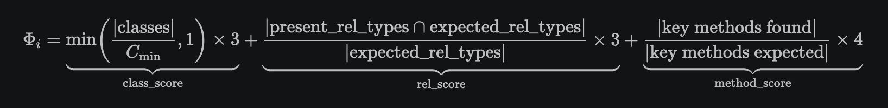
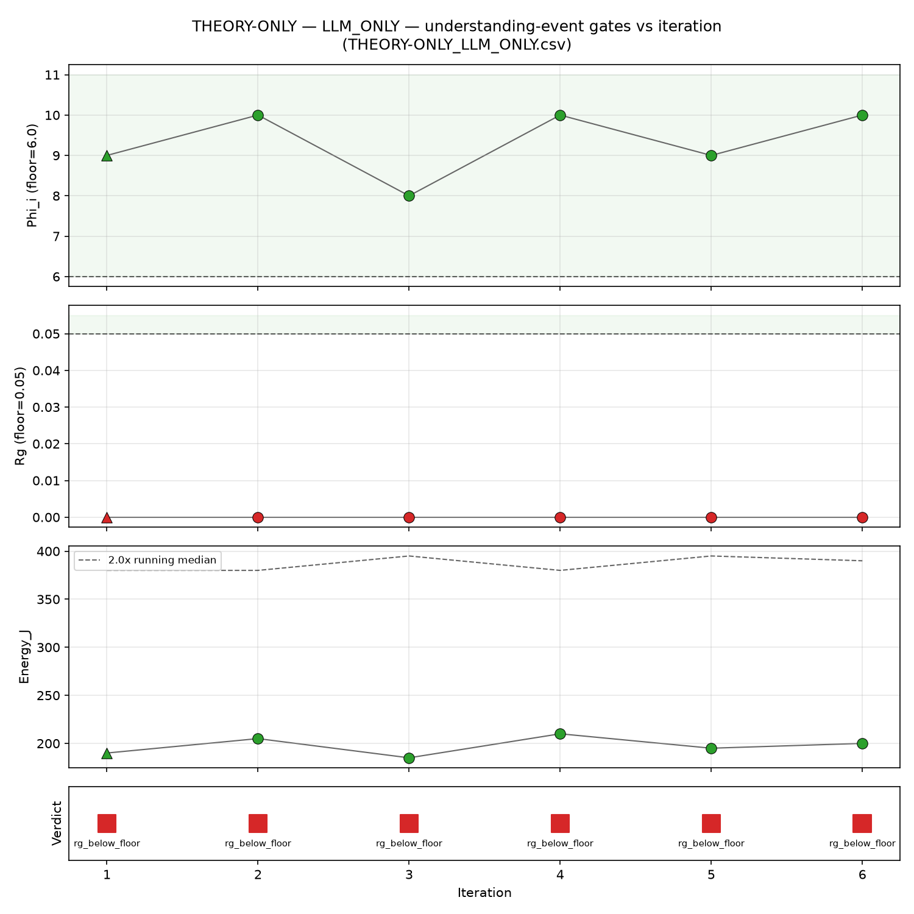
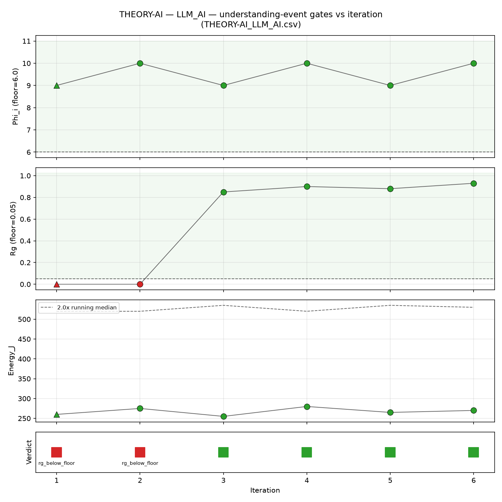
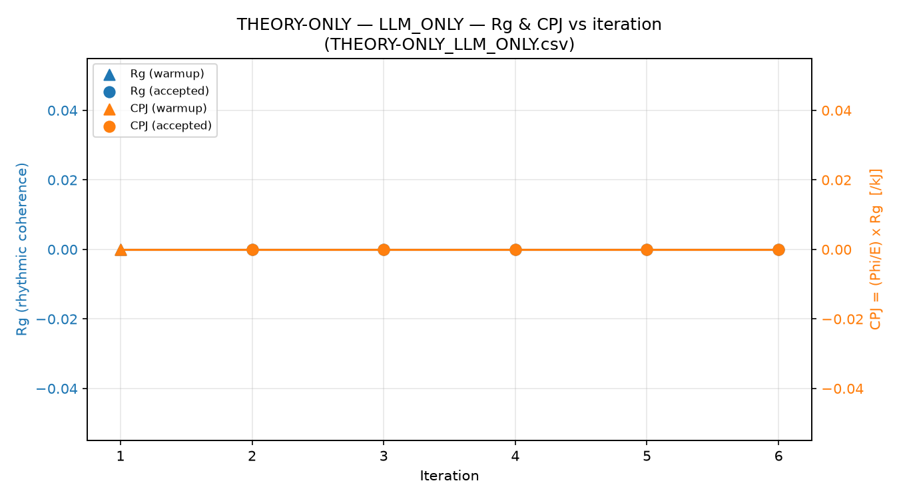
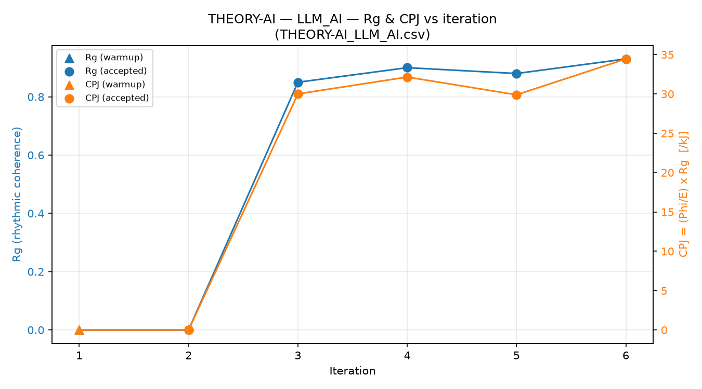
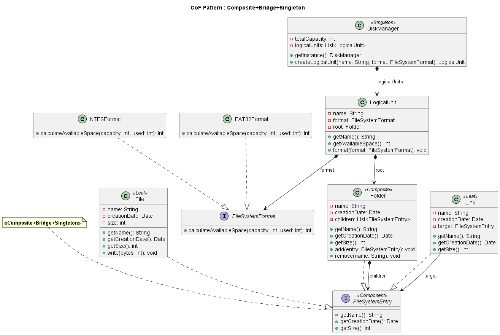

# Sovereign AI, CIITR, Gang of Four, Design Patterns, Karpathy Wiki Pattern

*Condensed summary of [README.md](../README.md) for a presentation or quick review.*

---

## 1. Starting point

Shortly before Christmas 2025, Tor-Ståle Hansen's article *"The Future Is Not 'the Cloud'"* (subtitle:
*"The Future Is Your Own Context, Running Inside Your Own RAM"*) caught my attention.

I have never fully believed in large general-purpose cloud LLMs for building sovereign industrial
applications: I prefer small, specialized models running locally.

This article has the advantage of looking beyond the cloud LLM:
an inference component (of any kind) running locally on silicon, whose energy use can be related to its own "understanding". Of course, understanding still has to be defined (see below).

I have an iMac M3 (Apple Silicon). I ran Llama 3.1 8B locally on it via MLX, Apple's library for
its chips, and I estimate, without any network call, the energy consumed per request. In the cloud, by contrast, there is no way to know how many joules were spent on a specific request: energy is opaque there.

The application described here is modest, and its goal was to teach me the concepts of the article:
- structural integration
- rhythmic coherence
- energy

---

## 2. What the gof1 sample application does

The gof1 application, which we will use as a test, solves a modeling problem by generating design-pattern class diagrams (GoF, "Gang of Four") from a question.

At startup, gof1 reads a rules file (.md) based on the ENST Bretagne Design Patterns course (A. Beugnard, 1999). That file plays the role of the CIITR LLM Instruction Schema Standard.

The application generates class diagrams in UML format according to one of two modes:

- **LLM_ONLY**: a single LLM call per iteration, with no memory.
- **LLM_AI**: an agent that learns in a loop, retaining memory from one run to the next.

At each iteration, gof1 does not only ask "is the diagram correct?" but also "has the system met the conditions for understanding: structure, rhythm, and energy?" (following Tor-Ståle Hansen's CIITR framework).

### Principle: an "agent" that learns and revises its beliefs

The "agent" keeps a notebook (the **wiki**). On each turn, it rereads its notes to guess the
pattern, generates the diagram, and then updates its notes with what it has learned. It is this loop,
repeated turn after turn, that creates a rhythm, and that rhythm is what gof1 measures (Rᵍ).

### The agent (called LLM_AI here): the Karpathy wiki pattern

The agent's beliefs live in a text document, the wiki, which the AI component (LLM or otherwise)
reads and then rewrites at each iteration.

Each iteration makes **three LLM calls**:

1. **Analysis** reads the question, the wiki, and the canonical GoF pattern rules (never modified), and detects the pattern.
2. **Generation** produces the diagram from the detected pattern.
3. If the diagram is accepted, the **wiki update** rewrites it with what was learned. The wiki will be read again on the next turn.

```
 GoF rules (static) ───────────────┐
 question (fixed for the session) ─┤
                                   v
        wiki ──────────► analysis ─► pattern ─► generation ─► diagram
         ^              [call 1]                [call 2]         │
         │                                                   (if accepted)
         └────────────────── wiki update ◄──────────────────────┘
                                [call 3]
```

### LLM_ONLY: a single call, no loop

There is no analysis and no wiki update. Only the generation call remains, receiving the question and the
GoF rules. No feedback loop exists: each iteration starts again from scratch. This is why rhythmic coherence under CIITR is zero: nothing loops, so there is no "rhythm" to measure.

---

## 3. The formulas

### The three measured values

| Symbol | Name | Definition |
|---------|------|------------|
| **Φᵢ** | Structural integration | class score (0-3) + relationship score (0-3) + key-method score (0-4) ∈ [0, 10], averaged over the declared patterns |
| **Rᵍ** | Rhythmic coherence | 1 − jitter, where jitter = σ/μ of the agent's throughput (tokens/s) |
| **E** | Energy | E = t × P (t = measured call duration, P = 12 W, estimated power of the iMac M3) |

### The Φᵢ formula

I started from a naive formula (number of classes with weight 1, number of relationships with weight 2) and refined it over time.

For each declared pattern, the diagram is compared to the expected schema for that pattern: minimum number of classes, expected relationship types, and key methods.



The score ranges from 0 to 10. If the LLM declares several patterns, Φᵢ is the **average** of the scores obtained for each.

*Example — Singleton*: 1 minimum class, no required relationship, and one key method (*getInstance*).
A diagram with one class that has *getInstance()* scores 3 + 3 + 4 = **10**. Without
*getInstance()*, it drops to 3 + 3 + 0 = **6**.

### Derived metrics

$$
C_i = \Phi_i \times R^g \qquad \text{CPJ} = \frac{C_i}{E}
$$

If either factor is zero, Cᵢ is zero.
In LLM_ONLY, Cᵢ = 0 even with a perfect Φᵢ, because Rᵍ = 0.

### The understanding zone

At each iteration, gof1 checks three tests combined with a logical AND:

| Test | Condition | Threshold |
|------|-----------|-----------|
| Φᵢ | Φᵢ ≥ threshold | 6.0 / 10 |
| Rᵍ | Rᵍ ≥ threshold | 0.05 |
| Energy | E ≤ 2 × median of the session's accepted energies | 2.0× |

**Why 0.05?** The Rᵍ level depends on the machine running the LLM: each hardware setup has its own speed profile. On the iMac M3, independent runs gave a stable Rᵍ, generally between 0.07 and 0.09. The threshold is placed just below this range: a clear degradation in rhythm will fail the test and take us out of the understanding zone. Of course, this is an empirical value derived from my tests.

For more details, please read *Why Understanding Is a Relational Property Between System, Structure, and Energy Cost* by Tor-Ståle Hansen.

### The four regimes

The result is recorded at each iteration, with a reason naming the first failing test:

| Reason | Situation | Regime (CIITR vocabulary) |
|--------|-----------|---------------------------|
| Φᵢ below threshold | Diagram too incomplete | Structural illusion |
| Rᵍ below threshold | Good diagram, but rhythm absent or erratic | Apparent competence |
| Energy too high | Energy cost too high for the session | CPJ collapse (CPJ → 0) |
| No failing test | All three tests pass | Validated understanding |

Energy is an independent condition from Φᵢ and Rᵍ: a correct diagram and a stable rhythm are not enough if the iteration is too expensive in energy terms.

---

## 4. Jitter, concretely

**Definition.** At each LLM call made by the agent (analysis and Karpathy wiki update),
we measure a throughput: tokens produced / seconds elapsed. Jitter is the dispersion
of these throughputs over the session:

$$
\text{jitter} = \frac{\sigma}{\mu} \qquad R^g = 1 - \text{jitter} \in [0, 1]
$$

with μ the mean throughput and σ the standard deviation. It is neither network latency nor the variation within a single call: it is the regularity of the agent's speed **from one call to the next**.

| | Throughputs (tokens/s) | μ | σ | jitter | Rᵍ |
|---|---|---|---|---|---|
| Stable rhythm | 12.5, 12.86, 12.7, 12.84, 12.26, 12.75 | 12.65 | 0.21 | **1.7 %** | **0.983** |
| Erratic rhythm | 3, 35, 2, 30, 4 | 14.8 | 14.55 | **98.3 %** | **0.017** |

In the erratic case, the agent does produce tokens (Rᵍ > 0), but it still fails the Rᵍ test because the criterion is Rᵍ ≥ 0.05, not merely Rᵍ > 0.

**Recomputed each iteration.** Rᵍ is recalculated at the start of each analysis from all completed cycles in the session. With fewer than 2 cycles, Rᵍ = 0: this is the cold start, not a failure.

**Known limitation: the order of throughputs is ignored.** σ/μ gives the same result regardless of the order of the samples:

| Sequence | Throughputs (tokens/s) | jitter |
|---|---|---|
| Steady acceleration (+2 tokens/s per call) | 10, 12, 14, 16, 18, 20 | 22.8 % |
| Same values, shuffled | 20, 10, 18, 12, 16, 14 | 22.8 % |

Rᵍ therefore cannot distinguish a steady drift from disordered noise with the same dispersion.

---

## 5. Reading the charts

Two charts are generated after each run: one for the three gates and one for Rᵍ/CPJ. The examples below use **synthetic** data where only Rᵍ varies, to show the expected pattern. Real-data versions are produced from each run's results.

### The three gates per iteration

| LLM_ONLY (Rᵍ = 0) | LLM_AI (Rᵍ > 0) |
|---|---|
|  |  |

Four bands: Φᵢ, Rᵍ, Energy, and then the verdict (green/red).

- **LLM_ONLY**: Φᵢ is good, but Rᵍ stays at zero. The verdict is red throughout (Rᵍ below threshold), regardless of diagram quality.
- **LLM_AI**: the first 2 iterations are red (cold start, to prevent the first LLM load from skewing compute times). Then Rᵍ rises above the threshold and stays there. The small back-and-forth of the curve between 0.85 and 0.93 **is** the jitter.

### Rᵍ and CPJ per iteration

| LLM_ONLY (Rᵍ = 0) | LLM_AI (Rᵍ > 0) |
|---|---|
|  |  |

Two separate axes (Rᵍ on the left, CPJ in /kJ on the right): look at the **shape**, not the values.

- **LLM_ONLY**: both curves are flat at 0, since Cᵢ = Φᵢ × 0 = 0.
- **LLM_AI**: both curves stay at 0 during the cold start, then rise **together**.

---

## 6. Going further

Read Tor-Ståle Hansen's documents on the CIITR framework, especially:
- *The Future Is Not 'the Cloud'*
- *Why Understanding Is a Relational Property Between System, Structure, and Energy Cost*

---

## Appendix — Example of a generated diagram: GOF-009 (LLM_AI)

**Objective** (session GOF-009): model FileSystem, a browsing tool inspired by
Windows Explorer. It relies on the disk management subsystem, supports several
formats (NTFS, FAT32), and contains files, folders, and links.



The agent combined three patterns, **Composite + Bridge + Singleton**:

- **Composite**: *FileSystemEntry* is the common component. *File* and *Link* are leaves,
  *Folder* is the composite that contains other *FileSystemEntry* objects (its children).
- **Bridge**: *LogicalUnit* (the abstraction) delegates the computation of available space to
  *FileSystemFormat* (the implementation). A format (*NTFSFormat*,
  *FAT32Format*...) can thus be added without touching *LogicalUnit*.
- **Singleton**: *DiskManager* is the single access point to the disk subsystem, and it is the one
  that creates the logical units.

The agent returns a structured description of the diagram (classes, relationships), which gof1 translates into
a UML diagram. The yellow note simply displays the declared pattern(s). Φᵢ is computed on these patterns:
classes, relationships, and the expected key methods for each one.

