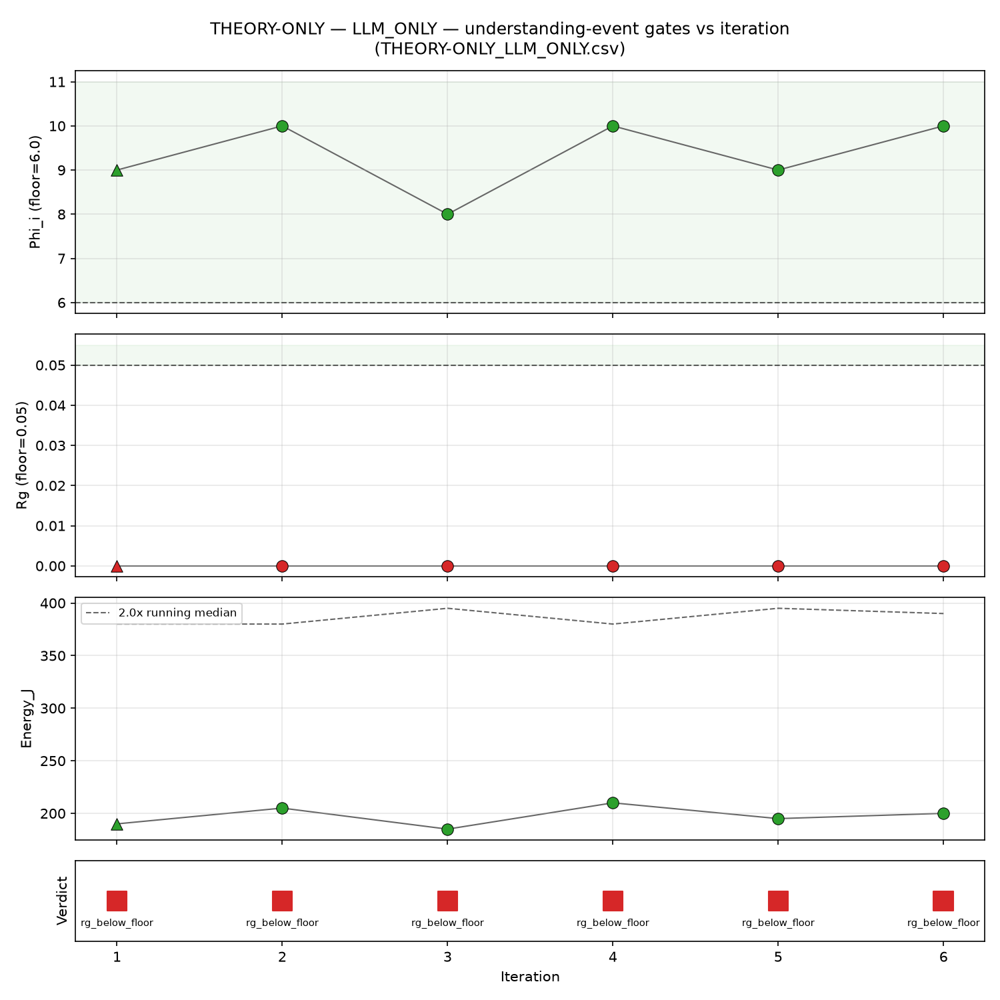
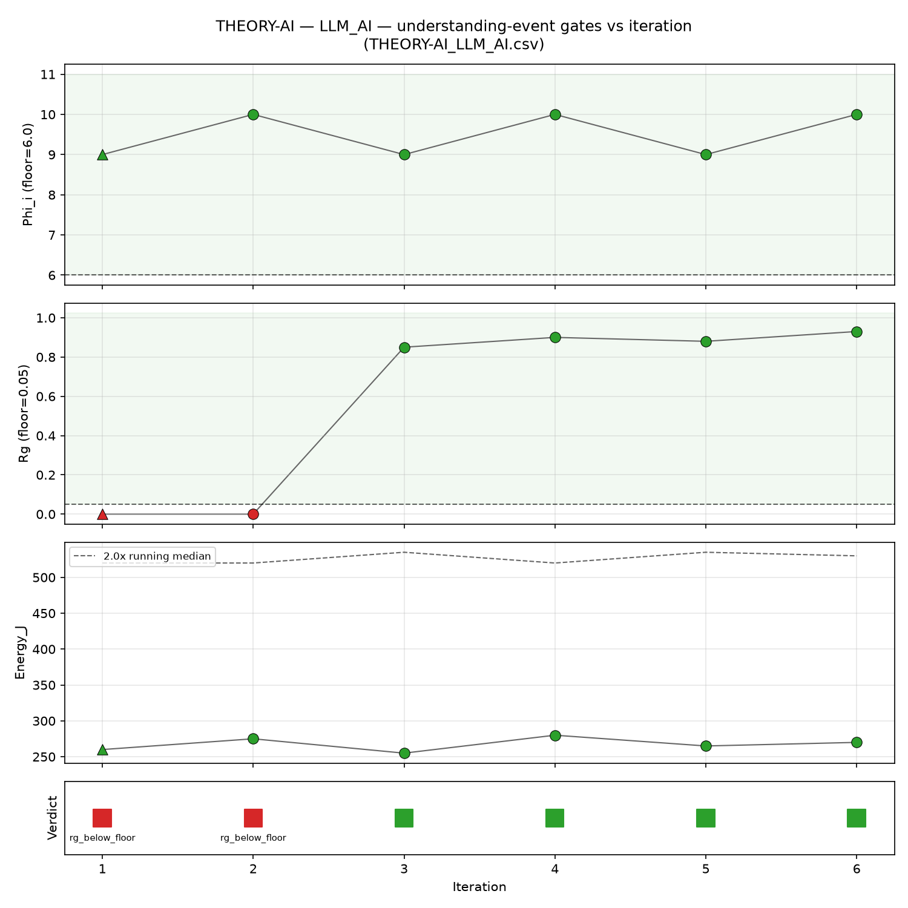
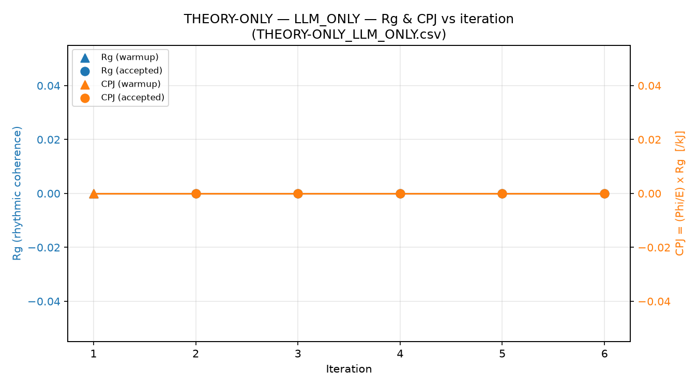
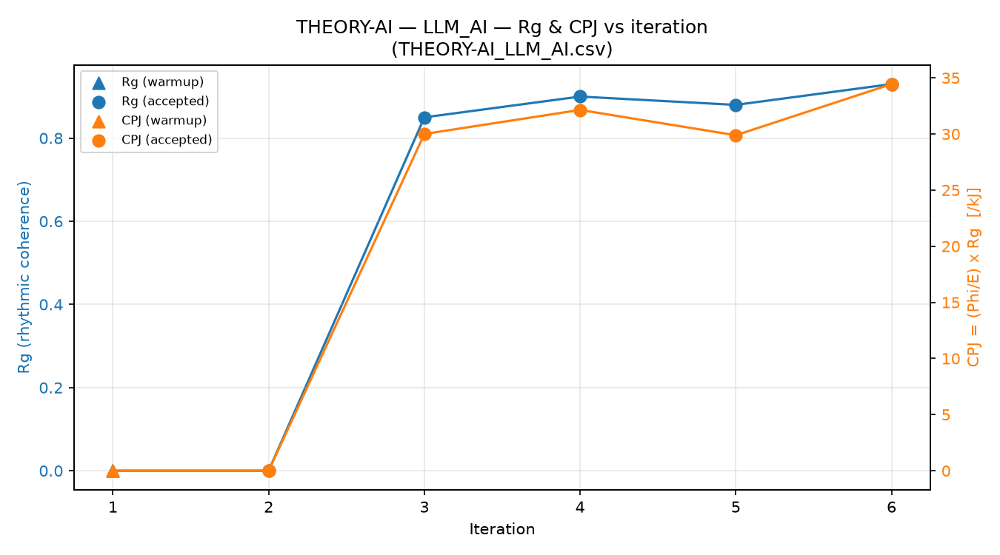
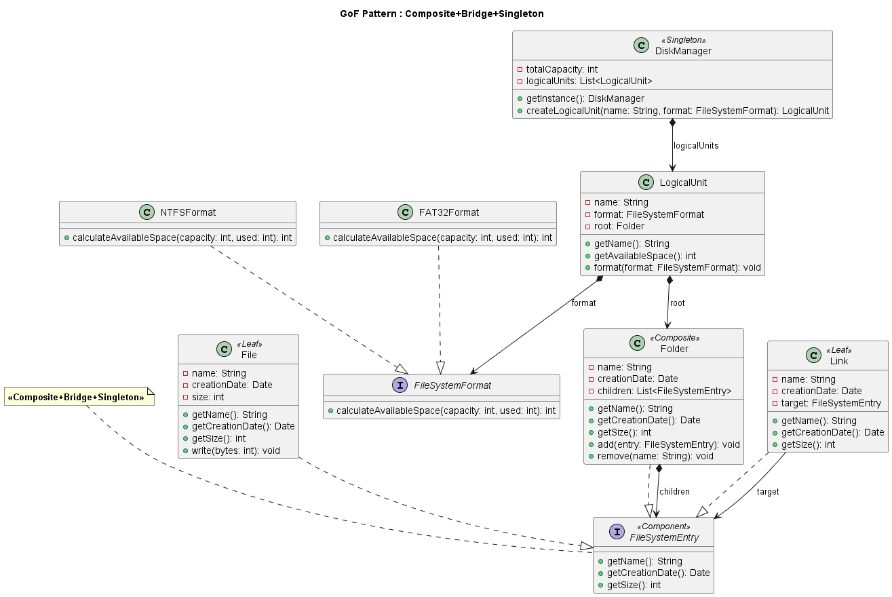

# Sovereign AI, CIITR, Gang of Four, Design Patterns, Karpathy Wiki Pattern

*Résumé condensé de [README.md](../README.md) pour présentation ou relecture rapide.*

---

## 1. Le point de départ

Un peu avant Noël 2025, l'article de Tor-Ståle Hansen *"The Future Is Not 'the Cloud'"* (sous-titre :
*"The Future Is Your Own Context, Running Inside Your Own RAM"*) a attiré mon attention.

Je n'ai jamais trop cru au gros LLM généraliste dans le cloud pour fabriquer des applications
industrielles souveraines : je préfère les petits LLM spécialisés, en local.

Cet article possède l'avantage de penser au-delà du LLM dans le cloud :
un composant d'inférence (de n'importe quelle nature d'ailleurs) qui tourne en local sur du silicium et dont on contrôle le bilan énergétique par rapport à sa « compréhension ». Reste évidemment à définir la « compréhension » (voir plus loin).

J'ai un iMac M3 (Apple Silicon) : j'y ai fait tourner Llama 3.1 8B en local, via MLX, la bibliothèque
d'Apple pour ses puces, et j'estime, sans appel réseau, l'énergie consommée par chaque demande.
Pour information, quand le LLM s'éxécute en local, c'est le seul moment où j'entends le ventilateur de mon mac M3.

Dans le cloud, au contraire, on ne peut pas savoir combien de joules ont servi à une requête donnée : l'énergie y est opaque.

L'application décrite ici est modeste et son objectif était de m'apprendre les concepts de l'article :
- l'intégration structurelle
- la cohérence rythmique
- l'énergie

---

## 2. Ce que fait l'application d'exemple gof1

L'application gof1,qui va nous servir de test, répond à un problème de modélisation en le résolvant à l'iade de designs patterns (GoF, "Gang of Four")

gof1 possède au démarrage un fichier de règles (.md) reprenant le cours Design Patterns de l'ENST Bretagne (A. Beugnard, 1999).
Ce fichier joue le rôle du LLM Instruction Schema Standard du CIITR.

L'application gof1 génère, à partir d'une question, des diagrammes de classes de Design Patterns au format UML selon l'un des deux modes:

- **LLM_ONLY** : un seul appel LLM par itération, sans mémoire.
- **LLM_AI** : un agent qui apprend en boucle, avec une mémoire qu'il garde d'un run à l'autre.

À chaque itération, gof1 ne demande pas seulement « le diagramme est-il correct ? », mais « le
système a-t-il réuni les conditions de la compréhension : structure, rythme, énergie ? » (suivant le cadre CIITR de Tor-Ståle Hansen).

### Le principe : un « agent » qui apprend et qui révise ses croyances

L'« agent », lui, tient un carnet de notes (le **wiki**). À chaque tour, il relit ses notes pour deviner le
pattern, génère le diagramme, puis met ses notes à jour avec ce qu'il a appris. C'est cette boucle,
répétée tour après tour, qui crée un rythme, et c'est ce rythme que gof1 mesure (Rᵍ).

### L'agent (que l'on nomme ici LLM_AI) : l'utilisation du pattern wiki d'Andrej Karpathy

Les croyances de l'agent vivent dans un document texte, le wiki, que le composant IA (LLM ou autre)
relit puis réécrit lui-même à chaque itération.

Chaque itération fait **trois appels LLM** :

1. L'**analyse** lit la question, le wiki et les règles canoniques des patterns GoF (jamais
   modifiées), et détecte le pattern.
2. La **génération** produit le diagramme à partir du pattern détecté.
3. Si le diagramme est accepté, la **mise à jour du wiki** le réécrit avec ce qui a été appris. Le wiki
   sera relu au tour suivant.

```
 règles GoF (statiques) ──────────┐
 question (fixe pour la session) ──┤
                                   v
        wiki ──────────► analyse ──► pattern ──► génération ──► diagramme
         ^              [appel 1]                [appel 2]          │
         │                                                   (si accepté)
         └────────────── mise à jour du wiki ◄─────────────────────┘
                                [appel 3]
```

### LLM_ONLY : un seul appel, pas de boucle

Ni analyse, ni mise à jour du wiki. Il reste l'appel de génération, qui reçoit la question et les
règles GoF. Pas de flèche de retour : chaque itération repart de zéro. C'est
pourquoi la cohérence rythmique sous CIITR est égale à zéro : rien ne boucle, il n'y a aucun "rythme" à mesurer.

---

## 3. Les formules

### Les trois valeurs mesurées

| Symbole | Nom | Définition |
|---------|-----|-----------|
| **Φᵢ** | Intégration structurelle | score classes (0-3) + score relations (0-3) + score méthodes clés (0-4) ∈ [0, 10], moyenné sur les patterns déclarés |
| **Rᵍ** | Cohérence rythmique | 1 − jitter, avec jitter = σ/μ des débits (tokens/s) de l'agent |
| **E** | Énergie | E = t × P (t = durée mesurée de l'appel, P = 12 W, puissance estimée de l'iMac M3) |

### La formule de Φᵢ

Je suis parti d'une formule naïve (nombre de classes avec une pondération de 1, nombre de relations avec une pondération de 2) pour l'affiner en cours de route.

Pour chaque pattern déclaré, le diagramme est comparé au schéma attendu de ce pattern : nombre
minimal de classes, types de relations attendus, méthodes clés.

$$\Phi_i = \underbrace{\min\left(\frac{\text{classes générées}}{\text{classes minimales}},\ 1\right) \times 3}_{\text{classes (0 à 3)}}
+ \underbrace{\frac{\text{types de relations attendus présents}}{\text{types de relations attendus}} \times 3}_{\text{relations (0 à 3)}}
+ \underbrace{\frac{\text{méthodes clés trouvées}}{\text{méthodes clés attendues}} \times 4}_{\text{méthodes (0 à 4)}}$$

Le score va de 0 à 10. Si le LLM déclare plusieurs patterns, Φᵢ est la **moyenne** des scores obtenus pour chacun.

*Exemple — Singleton* : 1 classe minimale, aucune relation imposée, une méthode clé (*getInstance*).
Un diagramme avec une classe qui possède *getInstance()* obtient 3 + 3 + 4 = **10**. Sans
*getInstance()*, il tombe à 3 + 3 + 0 = **6**.

### Métriques dérivées

$$C_i = \Phi_i \times R^g \qquad \text{CPJ} = \frac{C_i}{E}$$

Si l'un des deux facteurs est nul, Cᵢ est nul. 
En LLM_ONLY, Cᵢ = 0 même avec un Φᵢ parfait, puisque Rᵍ = 0.

### La zone de compréhension

À chaque itération, gof1 vérifie trois tests, combinés par un ET logique :

| Test | Condition | Seuil |
|-------|-----------|-------|
| Φᵢ | Φᵢ ≥ seuil | 6.0 / 10 |
| Rᵍ | Rᵍ ≥ seuil | 0.05 |
| Énergie | E ≤ 2 × médiane des énergies acceptées de la session | 2.0× |

**Pourquoi 0.05 ?** Le niveau de Rᵍ dépend de la machine qui fait tourner le LLM : chaque matériel a
son propre profil de vitesse. Sur l'iMac M3, des séries de runs indépendantes ont donné un Rᵍ
stable, toujours entre 0.07 et 0.09. Le seuil est placé juste sous cette plage : un rythme qui se
dégrade nettement fera échouer le test et nous fera sortir de la zone de compréhension.
Bien entendu, c'est une valeur empirique à partir de mes tests.

Pour plus de détails, lire *Why Understanding Is a Relational Property Between System, Structure, and Energy Cost* de
Tor-Ståle Hansen.

### Les quatre régimes

Le résultat est enregistré à chaque itération, avec une raison qui nomme le premier test en échec :

| Raison | Situation | Régime (vocabulaire CIITR) |
|--------|-----------|-----------------------------|
| Φᵢ sous le seuil | Diagramme trop incomplet | Illusion structurelle |
| Rᵍ sous le seuil | Bon diagramme, mais rythme absent ou erratique | Compétence apparente |
| Énergie trop élevée | Coût énergétique trop élevé pour la session | Effondrement du CPJ (CPJ → 0) |
| Aucun test en échec | Les trois tests passent | Compréhension validée |

L'énergie est une condition **indépendante** de Φᵢ et Rᵍ : un diagramme correct et un rythme stable
ne suffisent pas si l'itération coûte trop cher sur le plan énergétique.

---

## 4. Le jitter, concrètement

**Définition.** À chaque appel LLM de l'agent (analyse et mise à jour du wiki Karpathy), 
on mesure un débit : tokens produits / secondes écoulées. Le jitter est la dispersion
de ces débits sur la session :

$$\text{jitter} = \frac{\sigma}{\mu} \qquad R^g = 1 - \text{jitter} \in [0, 1]$$

avec μ la moyenne des débits et σ leur écart-type. Ce n'est ni la latence réseau, ni la variation
à l'intérieur d'un seul appel : c'est la régularité de la vitesse de l'agent **d'un appel à l'autre**.

| | Débits (tokens/s) | μ | σ | jitter | Rᵍ |
|---|---|---|---|---|---|
| Rythme stable | 12.5, 12.86, 12.7, 12.84, 12.26, 12.75 | 12.65 | 0.21 | **1.7 %** | **0.983** |
| Rythme erratique | 3, 35, 2, 30, 4 | 14.8 | 14.55 | **98.3 %** | **0.017** |

Dans le cas erratique, l'agent produit bien des tokens (Rᵍ > 0), mais il échoue quand même au test
Rᵍ, car le critère est Rᵍ ≥ 0.05, pas Rᵍ > 0.

**Recalculé à chaque itération.** Rᵍ est recalculé au début de chaque analyse à partir de tous les
cycles terminés de la session. Avec moins de 2 cycles, Rᵍ = 0 : c'est le démarrage à froid, pas un
échec.

**Limite connue : l'ordre des débits est ignoré.** σ/μ donne le même résultat quel que soit l'ordre
des échantillons :

| Séquence | Débits (tokens/s) | jitter |
|---|---|---|
| Accélération régulière (+2 tokens/s par appel) | 10, 12, 14, 16, 18, 20 | 22.8 % |
| Mêmes valeurs, mélangées | 20, 10, 18, 12, 16, 14 | 22.8 % |

Rᵍ ne distingue donc pas une dérive régulière d'un bruit désordonné de même dispersion.

---

## 5. Lire les graphiques

Deux graphiques sont générés après chaque run : les trois tests, et Rᵍ/CPJ. Ceux ci-dessous
utilisent des données **synthétiques** où seul Rᵍ varie, pour montrer la forme attendue. Les
versions sur données réelles sont produites avec les résultats de chaque run.

### Les trois tests par itération

| LLM_ONLY (Rᵍ = 0) | LLM_AI (Rᵍ > 0) |
|---|---|
|  |  |

Quatre bandeaux : Φᵢ, Rᵍ, Énergie, puis le verdict (vert/rouge).

- **LLM_ONLY** : Φᵢ est bon, mais Rᵍ reste à zéro. Le verdict est rouge de bout en bout
  (Rᵍ sous le seuil), quelle que soit la qualité du diagramme.
- **LLM_AI** : les 2 premières itérations sont rouges (démarrage à froid, pour éviter que le premier chargement du LLM ne fausse les temps de calcul).
Ensuite Rᵍ passe au-dessus du seuil et y reste. Le petit va-et-vient de la courbe entre 0.85 et 0.93 **est** le jitter.

### Rᵍ et CPJ par itération

| LLM_ONLY (Rᵍ = 0) | LLM_AI (Rᵍ > 0) |
|---|---|
|  |  |

Deux axes séparés (Rᵍ à gauche, CPJ en /kJ à droite) : on regarde la **forme**, pas les valeurs.

- **LLM_ONLY** : les deux courbes sont plates à 0, puisque Cᵢ = Φᵢ × 0 = 0.
- **LLM_AI** : les deux courbes restent à 0 pendant le démarrage à froid, puis montent **ensemble**.
 
---

## 6. Pour aller plus loin

Lire les documents de Tor-Ståle Hansen sur le cadre CIITR, notamment :
- *The Future Is Not 'the Cloud'*
- *Why Understanding Is a Relational Property Between System, Structure, and Energy Cost*

---

## Annexe — Exemple de diagramme généré : GOF-009 (LLM_AI)

**Objectif** (session GOF-009) : modéliser FileSystem, un outil de navigation inspiré de
l'Explorateur Windows. Il s'appuie sur le sous-système de gestion des disques, supporte plusieurs
formats (NTFS, FAT32) et contient des fichiers, des dossiers et des liens.



L'agent a combiné trois patterns, **Composite + Bridge + Singleton** :

- **Composite** : *FileSystemEntry* est le composant commun. *File* et *Link* sont des feuilles,
  *Folder* est le composite qui contient d'autres *FileSystemEntry* (ses enfants).
- **Bridge** : *LogicalUnit* (l'abstraction) délègue le calcul d'espace disponible à
  *FileSystemFormat* (l'implémentation). On peut ainsi ajouter un format (*NTFSFormat*,
  *FAT32Format*...) sans toucher à *LogicalUnit*.
- **Singleton** : *DiskManager* est le point d'accès unique au sous-système disque, et c'est lui
  qui crée les unités logiques.

L'agent renvoie une description structurée du diagramme (classes, relations), que gof1 traduit en
diagramme UML. La note jaune affiche simplement le(s) pattern(s) déclaré(s). C'est sur ces patterns
que Φᵢ est calculé : classes, relations et méthodes clés attendues pour chacun.
